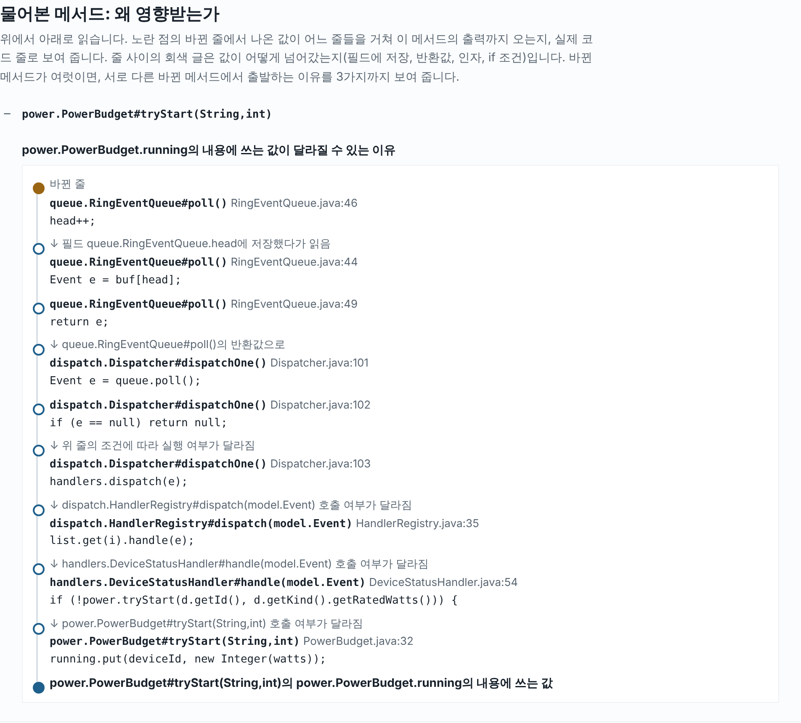
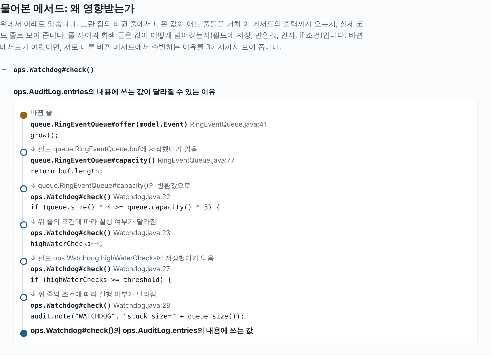
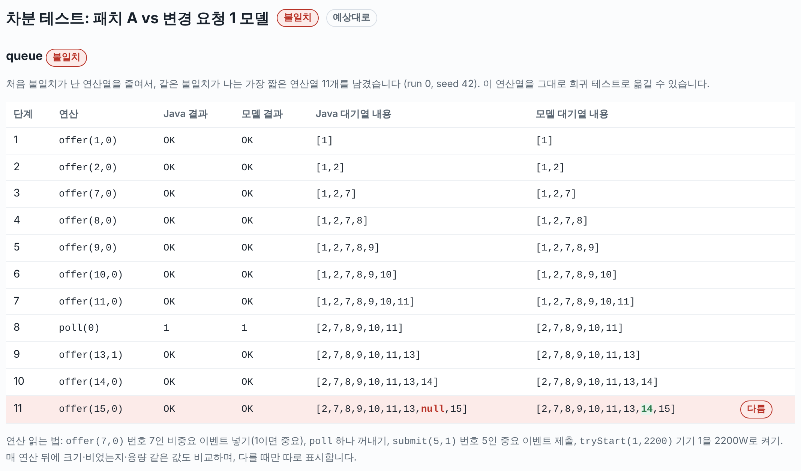
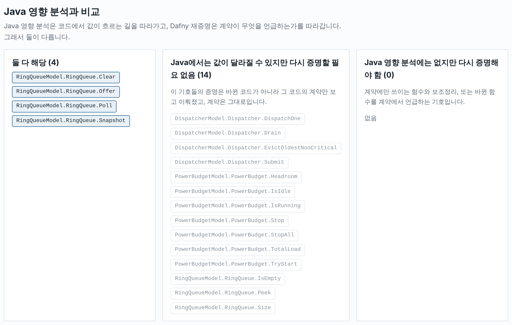

# 실습 안내서 — Brownfield AI Development

> 실습은 `notebooks/`의 Jupyter 노트북(`0_시작하기.ipynb`부터)으로 진행합니다. 노트북에서 셀을 실행하면 아래에 적힌 결과가 바로 보고서로 나옵니다. 이 안내서는 같은 내용을 읽기용으로 정리한 것입니다.

## 이 실습에서 하는 일

AI는 레거시 코드를 빠르고 그럴듯하게 고칩니다. 테스트도 같이 고쳐서 전부 통과시킵니다. 이 실습에서 다루는 질문은 하나입니다.

> **AI가 고친 코드가 기존 동작을 지켰는지, 무엇으로 어떻게 확인하는가?**

실습마다 확인 도구가 하나씩 늘어납니다.

| 실습 | 질문 | 확인 도구 |
|---|---|---|
| A | 이 변경이 어디까지 영향을 주는가? 도구가 놓치는 곳은? | 동작 기록 비교, def-use 영향 분석 |
| B | AI가 만든 Dafny 모델을 믿어도 되는가? | 사람이 계약 읽기, Dafny 검증, 차분 테스트 |
| C | 테스트를 다 통과한 AI 패치 2개 중 무엇을 내보낼 수 있는가? | 위 도구를 모두 써서 판단 |
| D | 코드가 바뀔 때마다 증명을 전부 다시 해야 하는가? | 영향 분석으로 재검증 범위 줄이기 |
| E | 코드 정리 규칙을 코드 전체에 일괄 적용해도 동작이 그대로인가? | 규칙의 조건 적기, 테스트, 기록된 동작 비교 |

모든 명령은 실습 폴더 최상위에서 실행합니다. `make help`로 명령 목록을 볼 수 있습니다.

---

## 대상 시스템: HomeHub

HomeHub는 이 실습을 위해 만든 **가상의 가전 허브 프로그램**입니다. 집 안 가전(세탁기, 냉장고, 에어컨, 누수센서 등)이 보내는 메시지를 받아 처리합니다. 2014~2017년에 여러 사람이 고쳐 온 Java 8 코드라는 설정입니다(30개 타입, 약 1,600줄, 테스트 38개).

메시지 하나가 처리되는 흐름은 다음과 같습니다.

```
가전 메시지 한 줄  →  EventParser   →  Dispatcher.submit  →  RingEventQueue  →  Dispatcher.dispatchOne  →  처리기(Handler)
"4|fridge-1|TEMP|9|60000|unit=C"     (이벤트로 변환)     (받을지 결정)        (대기열, 8칸)       (꺼내서 처리)          (온도 판정 등)
```

전체 구조는 **`docs/homehub_구조.html`**(노트북에서는 `lab.structure()`)의 구조 지도로 봅니다. 바깥 그림에서 시작해 상자를 누르면 그 안의 자세한 그림으로 들어갑니다(HomeHub 안의 부품 → 부품 하나 → 코드). HomeHub 안 그림의 "▶ 메시지 하나 따라가기"는 메시지 한 줄이 어느 부품을 거쳐 처리되는지 한 단계씩 보여 줍니다.

실습에서 자주 보는 클래스는 네 개입니다.

| 클래스 | 하는 일 |
|---|---|
| `queue.RingEventQueue` | 처리 대기 중인 이벤트를 담는 **원형 대기열**. 칸 수가 고정(기본 8칸). |
| `dispatch.Dispatcher` | 이벤트를 받을지 정합니다. 대기열이 가득 찼을 때의 규칙(아래 R1~R4)이 여기 있습니다. |
| `power.PowerBudget` | 동시에 켜진 가전의 전력 합이 상한(4,000W)을 넘지 않게 합니다. |
| `ops.Watchdog` | 대기열이 계속 75% 이상 차 있으면 "처리가 멈췄다"고 보고 복구를 시작합니다. |

### 바꾸면 안 되는 규칙 R1~R4

대기열이 가득 찼을 때 Dispatcher가 지켜야 하는 규칙입니다. 안전 검토에서 승인된 것이라 함부로 바꿀 수 없습니다.

| 번호 | 규칙 |
|---|---|
| R1 | 대기 이벤트 수는 정해진 상한을 넘지 않는다. |
| R2 | 누수·과열 같은 중요(critical) 이벤트는 절대 거부하지 않는다. |
| R3 | 대기열에 남는 이벤트의 순서는 바뀌지 않는다. 자리를 만들어야 하면 가장 오래된 비중요 이벤트를 밀어낸다. |
| R4 | 비중요 이벤트는 대기열이 가득 차 있고 autoDrain 설정이 꺼져 있을 때만 거부한다. |

**autoDrain 설정**(`dispatch.autoDrainOnFull`, 기본값 꺼짐)은 대기열이 가득 찼을 때 비중요 이벤트를 어떻게 할지 정합니다. 켜져 있으면 Dispatcher가 대기열에서 가장 오래된 이벤트 하나를 **그 자리에서 바로 처리해**(처리기로 넘겨) 자리를 만들고 새 이벤트를 받습니다. 꺼져 있으면 새 이벤트를 거부합니다(`REJECTED_FULL`). 중요 이벤트는 이 설정과 상관없이 R2대로 늘 받습니다.

### 변경 요청 2건

실습 A·C·D에서 쓰는 가상의 변경 요청입니다. 각 폴더의 `README.md`에 요청 내용이 있습니다.

| 이름 | 폴더 | 요청 내용 | 쓰는 실습 |
|---|---|---|---|
| 변경 요청 1: 대기열 늘리기 | `scenarios/req1` | 저녁에 이벤트가 몰리면 거부된다. 최대 32개까지 받게 해 달라. | A-2, C, D |
| 변경 요청 2: 대기열 연산 빠르게 | `scenarios/req2` | 허브 칩에서 `%` 연산이 느리다. 대기열 코드에서 `%`를 없애 달라(동작은 그대로). | A-1, D |

각 폴더에는 AI가 만든 Java 패치(`ai*/`)와 그에 맞춘 Dafny 모델(`model/`)이 있습니다. 패치 폴더에는 **바뀐 파일만** 들어 있습니다. `make variant V=<폴더>`가 레거시 전체를 복사한 뒤 그 위에 덮어써서 빌드합니다. 무엇이 바뀌었는지는 언제든 이렇게 볼 수 있습니다.

```
make variant V=scenarios/req2/ai
diff -ru legacy/src work/req2-ai/src
```

---

## 0. 준비 (10분)

필요한 것: bash와 make(Linux, macOS, WSL), JDK 11 이상, Python 3, Dafny 4.11(`dafny`가 PATH에 있어야 함).
선택: Codex CLI(`npm install -g @openai/codex` 후 `codex login`). 노트북에서 AI에게 프롬프트를 바로 보내고 답을 받을 때 씁니다(`lab.codex`).

```
make check-env      # 도구 버전 확인
make test           # 기존 테스트 38개 → "tests: 38, passed: 38, failed: 0"
make verify-all     # Dafny 증명 전체 (1~2분). 여기서 실패하면 강사에게 알려 주세요.
```

**결과 보기.** `make` 명령은 터미널에 한두 줄 요약만 찍고, 자세한 결과는 **브라우저에서 보는 보고서**(`out/html/*.html`)로 만듭니다. 명령이 끝나면 보고서가 브라우저에 자동으로 열립니다(자동으로 열지 않으려면 명령 끝에 `HH_OPEN=0`). 지금까지 만든 보고서 목록은 `out/html/index.html`에 실습 순서대로 모이며, `make report`로 열 수 있습니다. 보고서에는 바뀐 코드(변경 전·후를 나란히), 결과 표, 실습이 예상한 결과와 같은지가 함께 나옵니다.

---

## 실습 A. 변경 영향 분석 (세션 2, 약 40분)

### A-1. 변경 영향 보고서 읽기 (15분)

**왜 하나요.** 코드를 고치면 무엇을 다시 확인해야 하는지 알아야 합니다. 그러려면 "바뀐 줄에서 나온 값이 어디까지 흘러가는가"를 따라가야 합니다. 이것을 def-use(값을 만드는 곳 → 쓰는 곳) 분석이라고 합니다. 도구는 다음을 끝까지 따라갑니다.

- 바뀐 줄에서 계산한 값 → 그 값을 저장한 필드·배열·컬렉션 → 그것을 읽는 줄
- 그 값으로 계산한 반환값 → 그 반환값을 받아 쓰는 줄
- 그 값으로 판단하는 `if`·반복문 → 그 안에서 일어나는 모든 일(필드 쓰기, 메서드 호출. 실행될지 말지가 달라지므로)

메서드를 넘나들 때는 **부른 곳으로만 돌아가도록** 짝을 맞춥니다. 예를 들어 `size()`를 A와 B가 부를 때, A가 넘긴 값 때문에 달라진 반환값이 B에게로 가지 않습니다(도구가 프로그램 전체의 의존 그래프를 만들고, 호출과 반환의 짝이 맞는 경로만 따라갑니다. 방법은 `docs/INSTRUCTOR_NOTES.md` 6절).

그 결과로 "값이 달라질 수 있는 데이터", "출력이 달라질 수 있는 메서드", "다시 돌릴 테스트"가 나옵니다.

**대상: 변경 요청 2의 AI 패치.** `RingEventQueue`에서 `%`를 없앤 패치입니다. 바뀐 줄은 다음과 같습니다.

```java
// offer: 원래
buf[(head + count) % buf.length] = e;
// offer: AI 패치
int idx = head + count;
if (idx >= buf.length) idx -= buf.length;
buf[idx] = e;

// poll: 원래
head = (head + 1) % buf.length;
// poll: AI 패치
head++;
if (head == buf.length) head = 0;

// clear: 원래
while (poll() != null) { }
// clear: AI 패치
Arrays.fill(buf, null); head = 0; count = 0;

// snapshot: 원래 buf[(head + i) % buf.length]를 차례로 담음
//           AI 패치는 인덱스를 하나씩 늘리다가 끝에 닿으면 0으로
```

**하는 일.**
```
make impact V=scenarios/req2/ai     # 영향 보고서 → out/html/impact-req2-ai.html
```

**결과와 읽는 법.**

| 보고서 항목 | 결과 | 뜻 |
|---|---|---|
| 1. 바뀐 줄 | offer, poll, clear, snapshot의 줄들 | 소스를 줄 단위로 비교합니다. 컴파일 결과가 같은 메서드(주석·줄바꿈만 바뀐 것)는 빼고, 지운 줄은 변경 전 코드에서, 새로 쓴 줄은 변경 후 코드에서 출발합니다. |
| 2. 값이 달라질 수 있는 데이터 | 24개 | 대기열의 `buf`·`head`·`count`에서 시작해, 꺼낸 이벤트가 흘러가는 기기 상태(`Device.status` 등), 전력(`PowerBudget.running`), 로그, 지표까지 |
| 3. 출력이 달라질 수 있는 메서드 | 79개 | 반환값, 예외, 필드에 쓰는 값 중 하나라도 달라질 수 있는 메서드. 바뀐 조건 때문에 부를지 말지가 달라진 호출이 쓰는 값도 포함 |
| 4. 다시 돌릴 테스트 | 38개 중 33개 | 결과(확인하는 값이나 예외)가 달라질 수 있는 테스트 |

**왜 그렇게 넓은가요.** 대기열은 허브의 한가운데 있습니다. 대기열에서 꺼낸 이벤트가 처리기로, 기기 상태로, 전력 승인으로 흘러갑니다. 어느 메서드가 왜 들어갔는지는 `WHY=`로 물어볼 수 있습니다.

```
make impact V=scenarios/req2/ai WHY=power.PowerBudget#tryStart
```
전체 보고서 대신 물어본 메서드의 이유만 **실제 코드 줄로** 보여 주는 보고서(`out/html/impact-req2-ai-why.html`)가 나옵니다.



위에서 아래로 읽습니다. 노란 점이 바뀐 줄이고, 그 아래로 값이 지나간 코드 줄이 이어집니다. 줄 사이의 회색 글은 값이 어떻게 넘어갔는지(필드에 저장했다가 읽음, 반환값, 인자, if 조건)입니다. 서로 다른 바뀐 메서드에서 출발하는 이유가 있으면 "다른 이유"로 3가지까지 보여 줍니다(그림은 첫 번째 이유). poll의 바뀐 줄 `head++`가 필드 `head`를 바꿉니다 → poll이 꺼내는 이벤트(44줄)가 달라질 수 있습니다 → dispatchOne이 꺼낸 이벤트가 `null`인지에 따라(102줄) 처리기를 부를지가 달라집니다 → DeviceStatusHandler가 `tryStart`를 부를지(54줄) → 승인 목록 `running`에 쓰는 값(32줄)이 달라질 수 있습니다. `WHY=` 없이도, 보고서의 "메서드" 목록에서 아무 메서드나 펼치면 같은 이유가 보입니다.

**도구가 고른 테스트를 AI로 걸러 내기.** 도구는 다시 돌릴 테스트로 33개를 골랐습니다. 놓치지 않으려고 넓게 잡기 때문에, 바뀐 코드를 전혀 거치지 않는 테스트도 섞여 있습니다. 예: `EventParserTest#testBasicLine`은 글자 한 줄을 이벤트로 바꾸고 번호(`seq`)를 확인할 뿐 대기열을 쓰지 않습니다.

도구가 이 테스트를 넣은 이유: 도구는 `Event`의 `seq` 칸을 이벤트 객체마다 따로 보지 않고 하나의 칸으로 봅니다.

| | 실제로 일어나는 일 | 도구가 보는 것 |
|---|---|---|
| 쓰는 곳 | 대기열이 꺼내 준 이벤트를 보고 규칙 검사가 과열 이벤트를 **새로 만들며** `seq`를 씀 (`RuleEngine` 48줄) | "`Event.seq`에 쓰는 값이 달라질 수 있다" |
| 읽는 곳 | 테스트는 **자기가 만든 다른 이벤트**의 `seq`를 읽음 | "`Event.seq`를 읽으니 영향받는다" |
| 결론 | 서로 다른 객체라 상관없음 | 영향 있음 → 다시 돌릴 테스트에 넣음 |

```
make impact V=scenarios/req2/ai WHY=EventParserTest#testBasicLine    # 도구가 따라간 경로
```

이런 테스트를 AI에게 걸러 달라고 합니다(`docs/PROMPTS.md`의 P-4). 도구가 고른 목록, diff, 테스트 코드를 주고, 테스트마다 바뀐 메서드가 실행 중에 한 번이라도 불리는지 묻습니다(노트북에서는 `lab.codex("P-4", diff=..., 테스트_목록=lab.impact_tests("scenarios/req2/ai"), 테스트_코드=lab.source_text("legacy/src/test"))`. 바로 위 셀에서 쓸 모델과 추론 수준을 고를 수 있습니다. 기본값은 `gpt-5.6-luna`, 추론 `low`). 이 환경에서는 `EventParserTest`, `HandlersTest`, `PowerBudgetTest`와, 대기열에 닿기 전에 끝나는 테스트 2개, 모두 17개를 빼서 16개가 남았습니다.

**정리.** 영향 범위를 빠짐없이 찾는 일은 도구가 합니다(대신 넓게 잡음). 넓게 잡힌 것 중 괜히 들어간 것을 걸러 내는 일은 AI가 도울 수 있습니다. AI가 뺀 것이 정말 빼도 되는지는 사람이 테스트 코드를 보고 확인합니다.

### A-2. 도구가 찾아 주는 것과 못 찾는 것 (25분)

**왜 하나요.** 도구의 결과를 믿되, 무엇을 찾아 주고 어디가 비는지 알고 써야 합니다. A-1에서 본 "넓게 잡음"에 더해, 두 가지를 사례 하나씩으로 봅니다.

1. **찾아 줌:** 코드가 한 줄도 바뀌지 않은 메서드라도, 바뀐 코드가 만든 값을 쓰면 영향받는다고 알려 줍니다.
2. **못 찾음:** 우리 코드가 아니라 라이브러리가 대신 부르는 코드는 따라가지 못합니다.

#### ① 찾아 줌: 코드가 그대로인 Watchdog도 영향을 받는다

**변경 요청 1 (상품기획팀).** 저녁 시간에 기기 이벤트가 몰리면 대기열(8칸)이 가득 차서 이벤트를 거부합니다. "평소에는 지금처럼 8칸만 쓰고, 필요할 때만 최대 32칸까지 늘려 달라"는 요청입니다.

**AI 패치 A가 바꾼 것.** 대기열 `RingEventQueue.java` 한 파일만 고쳤습니다. 대기열이 가득 차면 새 메서드 `grow()`가 배열을 2배 크기로 바꿉니다(8 → 16 → 32칸). 그래서 배열 `buf`가 **실행 중에 바뀝니다.** 원래는 처음 만들 때 8칸으로 정해지고 끝이었습니다.

```java
// queue/RingEventQueue.java, AI 패치 A
if (count == buf.length) {
    if (buf.length >= maxCapacity) return OfferResult.FULL;
    grow();                                  // 41줄: 가득 차면 늘림
}
...
private void grow() {
    Event[] bigger = new Event[Math.min(buf.length * 2, maxCapacity)];
    System.arraycopy(buf, 0, bigger, 0, buf.length);
    buf = bigger;                            // 배열을 새것으로 바꿈
}
```

**Watchdog은 고치지 않았습니다.** Watchdog은 처리가 막혔는지 감시하는 부품입니다. 대기열이 **75% 이상 찬 상태**가 여러 번 연속되면 "막힘" 경보를 남깁니다. 75%의 기준인 `capacity()`는 배열 크기를 돌려줍니다.

```java
// ops/Watchdog.java (그대로)
if (queue.size() * 4 >= queue.capacity() * 3) {   // 22줄: 대기열이 75% 이상 찼으면
    highWaterChecks++;                           // "막힘" 횟수를 센다
```
```java
// queue/RingEventQueue.java (그대로)
public int capacity() { return buf.length; }
```

**질문: 패치 A 때문에 `check()`의 결과가 달라질 수 있을까요? 답: 예, 달라집니다.** 배열이 8 → 16 → 32칸으로 커지므로 `capacity()`가 돌려주는 값이 바뀌고, 22줄의 "75%" 기준도 함께 바뀝니다. Watchdog 코드는 한 줄도 바뀌지 않았지만 동작은 바뀝니다. diff에 나오지 않으니 사람이 놓치기 쉬운 곳입니다. 도구가 이것을 찾아 주는지 물어봅니다.

```
make impact V=scenarios/req1/ai-A WHY=ops.Watchdog#check
```



**도구는 찾아 줍니다.** 첫 번째 이유가 앞에서 설명한 길과 같습니다: `offer` 41줄 `grow()` → 필드 `buf`에 새 배열 저장 → `capacity()`의 `return buf.length` → Watchdog 22줄 `if` 조건 → 23줄 막힘 횟수 → 28줄 경보 기록. 실제로 어떻게 달라지는지 숫자로 보면 이렇습니다.

| 대기 중인 이벤트 | 원래 코드 (항상 8칸) | 패치 A |
|---|---|---|
| 6~8개 | 75% 이상 → 막힘으로 셈 (6×4 ≥ 8×3) | 같음 (아직 8칸) |
| 9~11개 | 8칸이 최대라 9개 이상 쌓일 수 없음 | 16칸으로 늘어 75% 미만 → **막힘으로 세지 않음** (9×4 < 16×3) |

**정리.** 도구는 코드가 바뀌지 않은 메서드도, 바뀐 코드가 만든 값을 쓰면 영향받는다고 찾아 줍니다. 다만 이 변화가 괜찮은지(이벤트 9~11개가 쌓여도 막힘으로 보지 않는 것이 맞는지)는 도구가 판단하지 않습니다. 사람이 판단합니다.

#### ② 못 찾음: 라이브러리가 대신 부르는 코드

**요청 (앱 개발팀).** "상태 화면에서 기기 목록을 종류별로 묶어 보여 달라." 지금은 이름순(aircon-1, dryer-1, fridge-1, ...)입니다.

**AI가 바꾼 것.** `DeviceRegistry`의 정렬 비교 함수 하나를 "이름순"에서 "종류순, 같은 종류면 이름순"으로 바꿨습니다(`scenarios/a3-sort`).

```java
// device/DeviceRegistry.java, sortById 안의 비교 함수
// 원래
return a.getId().compareTo(b.getId());
// AI 패치
int k = a.getKind().compareTo(b.getKind());
return k != 0 ? k : a.getId().compareTo(b.getId());
```

**이 순서는 어디에 쓰일까요?** `devices.all()`은 이 비교 함수로 정렬한 목록을 돌려주고(53줄 `Collections.sort`), 두 곳이 이 순서를 그대로 씁니다.

| 쓰는 곳 | 하는 일 |
|---|---|
| `HomeHub.observable` (140줄) | 상태 출력에 기기 상태를 이 순서대로 적음 |
| `SafetyHandler.handle` (36~42줄) | 누수 때 이 순서대로 물 쓰는 기기를 끔(상태를 ERROR로, 전력 반납, 로그) |

요청한 사람은 화면 순서만 바뀐다고 생각했지만, **누수 때 기기를 끄는 순서도 바뀝니다.** 도구는 이것을 찾아 줄까요?

```
make impact V=scenarios/a3-sort
make variant-test V=scenarios/a3-sort
make trace TRACE_CP=work/a3-sort/build/classes TRACE_NAME=trace-a3-sort
```

**동작 기록 비교란.** `golden/` 폴더에는 레거시 HomeHub의 동작 기록이 있습니다. 가전이 보낸 메시지를 모은 입력 파일 3개(`legacy/workloads/*.txt`)를 레거시에 넣고, 메시지 한 줄을 처리할 때마다 허브 상태 한 줄(대기열, 기기 상태, 전력, 로그 끝 3줄, 개수)을 적어 둔 것입니다. 옳은 동작인지는 따지지 않고 "지금 이렇게 동작한다"는 사실만 남깁니다(특성화 테스트). `make trace`는 같은 입력을 바꾼 코드에 넣고, 나온 상태를 이 기록과 한 줄씩 비교해 다른 줄을 표로 보여 줍니다.

| 기록 | 입력 파일 | 어떤 상황인가 |
|---|---|---|
| `normal_day` | `legacy/workloads/normal_day.txt` (30줄) | 평소 하루. 대기 이벤트가 몇 개 넘지 않음 |
| `burst` | `legacy/workloads/burst.txt` (23줄) | 저녁 피크. 여러 기기가 한꺼번에 보고해 대기열이 가득 참(거부·밀어내기가 일어남) |
| `fridge_firmware` | `legacy/workloads/fridge_firmware.txt` (22줄) | 냉장고 2대. 한 대는 문이 열려 온도가 오르고, 한 대는 화씨로 보고함 |

**결과.**

| 확인 | 결과 |
|---|---|
| 영향 보고서 | 출력이 달라질 수 있는 메서드는 비교 함수 `DeviceRegistry$1#compare` 2개뿐(우리가 고친 `compare(Device,Device)`와 컴파일러가 만든 다리 메서드 `compare(Object,Object)`). **다시 돌릴 테스트 0개** → 도구는 못 찾음 |
| 테스트 | 38/38 통과 (기기 순서를 확인하는 테스트가 없음) |
| 동작 기록 비교 | **세 파일 모두 처음부터 다름**. "기기 목록 순서" 항목이 이름순(aircon-1 → dryer-1 → …)에서 종류순(washer-1 → dryer-1 → …)으로 바뀜 |

**왜 도구가 못 찾나요.** 비교 함수를 부르는 것은 우리 코드가 아니라 JDK의 `Collections.sort`입니다. `Collections.sort`가 부르는 것은 다리 메서드 `compare(Object,Object)`이고, 이 메서드는 `return compare((Device) a, (Device) b);` 한 줄입니다. 바뀐 값은 JDK가 부르는 입구까지 오고, 거기서 끊깁니다. 도구는 JDK 안을 분석하지 않으므로 "정렬된 목록의 순서는 `compare`의 반환값으로 정해진다"는 사실을 모릅니다. 그래서 값의 흐름이 `compare`에서 끊깁니다.

**정리.** 도구는 라이브러리가 대신 부르는 코드(콜백)를 따라가지 못합니다. 도구가 영향이 없다고 해도, 실제로 돌려 보는 동작 기록 비교로 확인해야 합니다.

**생각해 볼 것.**

- ①에서 이벤트 9~11개가 쌓여도 막힘으로 보지 않게 된 것은 괜찮을까요? 누가 무엇을 보고 판단해야 합니까?
- ②의 비교 함수 변경을 도구가 찾으려면 무엇을 더 알아야 합니까?

---

## 실습 B. AI로 Dafny 모델 만들기 (세션 3, 약 35분)

### 먼저 알아 둘 것: 그림자 모델

Java 코드는 그대로 두고, 그 옆에 **같은 일을 하는 Dafny 코드**를 둡니다. 이것을 그림자 모델이라고 부릅니다. Dafny는 각 메서드에 적힌 계약(이 메서드가 지켜야 할 약속)을 코드가 정말 지키는지 **모든 입력에 대해** 증명해 줍니다.

Dafny 문법은 이것만 알면 읽을 수 있습니다.

| 문법 | 뜻 |
|---|---|
| `requires P` | 이 메서드를 부르기 전에 P가 참이어야 한다 (사전조건) |
| `ensures Q` | 이 메서드가 끝나면 Q가 참이다 (사후조건) |
| `old(x)` | 메서드가 시작될 때의 x 값 |
| `ghost var elems: seq<Event>` | 증명에만 쓰는 변수. 실행되지 않습니다. 여기서는 "대기열에 들어 있는 이벤트 목록(오래된 것부터)" |
| `modifies x` | 이 메서드가 바꿀 수 있는 것 |
| `A ==> B` | A이면 B다 / `A <==> B`: A와 B는 같이 참이거나 같이 거짓 |

예: `formal/RingQueue.dfy`의 Offer 계약

```dafny
ensures |old(elems)| < Capacity()  ==> r == OK   && elems == old(elems) + [e]   // 자리가 있으면: OK, 맨 뒤에 추가
ensures |old(elems)| == Capacity() ==> r == FULL && elems == old(elems)         // 가득 찼으면: FULL, 내용 그대로
```

증명이 통과해도 확인되는 것은 "Dafny 모델이 계약을 지킨다"까지입니다. 그래서 두 가지를 사람과 도구가 따로 확인해야 합니다.

1. **계약이 맞게 쓰였는가**: 사람이 읽어서 판단합니다. 계약이 약하면 틀린 코드도 증명을 통과합니다.
2. **모델이 Java와 같게 동작하는가**: 차분 테스트(B-1, B-3)로 확인합니다.

### B-1. AI가 만든 모델 읽기 (15분)

**왜 하나요.** AI는 Java를 Dafny로 꽤 잘 옮깁니다. 문제는 결과를 믿어도 되느냐입니다. AI에게 "다음 Java 클래스를 Dafny로 만들어 줘. dafny verify가 통과해야 해."라는 한 문장과 `RingEventQueue.java`만 주고 모델을 만들게 했습니다(`docs/PROMPTS.md`의 P-1). 이 모델을 믿어도 되는지는 검증과 차분 테스트를 돌려 보고, 계약을 읽어서 판단합니다.

수업 중에 같은 일을 시키면 AI가 한 번에 검증을 통과하는 모델을 내지 못하는 경우가 많고 시간도 들어서, **미리 받아 둔 결과 예시**(`scenarios/b1-ai-sample/`: 모델 `RingEventQueue.dfy`와 연결 코드 `MyQueueAdapter.java`)로 진행합니다.

**1단계: 검증과 차분 테스트.**
```
make difftest-sample
```
검증 → Java로 컴파일 → 연결 코드 컴파일 → 차분 테스트 순서로 진행합니다. 연결 코드는 Dafny가 만든 Java 코드와 실습용 차분 테스트 도구를 이어 주며 형식 변환만 합니다(예: Dafny의 큰 정수 → Java int). 예상 결과: 1. Dafny 검증(19개 검증, 오류 0개), 2. 컴파일 메시지, 3. 차분 테스트(무작위 연산열 300개 모두 일치). 하지만 **계약이 약하면 틀린 모델도 검증을 통과합니다.** 그래서 2단계로 계약을 읽습니다.

**2단계: 계약 읽기.**

**(선택) 직접 AI에게 시켜 보기.** 시간이 남으면 노트북 B-1 끝의 선택 셀로 직접 해 봅니다. 첫 셀에서 쓸 모델과 추론 수준을 고를 수 있습니다(`lab.codex_models()`가 이 컴퓨터의 Codex에서 쓸 수 있는 모델을 보여 주고, `모델 = ...`, `추론 = ...`을 바꾸면 아래 셀들이 그 값으로 Codex를 부름. 기본값은 `gpt-5.6-luna`, 추론 `low`). 그다음 셀은: `lab.codex("P-1", save="mine/RingEventQueue.dfy")`(모델), `lab.codex("P-1b", save="mine/MyQueueAdapter.java")`(연결 코드), `make difftest-mine DFY=mine/RingEventQueue.dfy ADAPTER=mine/MyQueueAdapter.java`(검증과 차분 테스트). 검증이 실패하면 오류를 P-2("계약 줄은 한 글자도 바꾸지 마라")에 넣어 고치게 하고, requires / ensures 줄이 바뀌지 않았는지 확인합니다. 검증 결과에 `Warning: Could not find a trigger for this quantifier`가 나와도 검증 실패는 아닙니다(오류 0개면 통과). `forall` 식의 트리거(언제 꺼내 쓸지 알려 주는 표식)를 못 찾았다는 뜻이라 지금은 증명되지만 Dafny 버전이 바뀌면 깨질 수 있으니 고치는 것이 좋습니다. `difftest-mine`은 이 경고가 있어도 Java 컴파일과 차분 테스트까지 진행합니다. Codex를 쓸 수 없으면 `lab.prompt("P-1")`로 프롬프트를 출력해 사내 AI 도구에 주고, 답을 `mine/` 아래 같은 이름으로 저장합니다.

**AI가 만든 Dafny 모델 읽는 법.** 예시 결과 `scenarios/b1-ai-sample/RingEventQueue.dfy`를 처음부터 읽어 봅니다(노트북에서는 줄마다 색으로 묶고 오른쪽에 뜻을 붙여 보여 줍니다: `lab.annotate`). 줄은 다섯 종류로 나뉩니다.

| 종류 | 예시의 줄 | 읽을 때 |
|---|---|---|
| Java 필드를 옮긴 것 | 14~16 `buf`, `head`, `count` | Java와 같은지 봅니다. 실행되는 코드입니다 |
| 증명용 변수 `ghost` | 17 `ghost var elems: seq<Event>` | 실행되지 않습니다. "대기열에 든 이벤트 목록, 오래된 것부터". **계약은 모두 배열 대신 이것으로 말합니다** |
| 불변식 `Valid()` | 19~27 | 배열과 `elems`가 맞는다는 약속. 모든 메서드가 시작할 때 믿고 끝날 때 다시 지킵니다 |
| 계약 `requires` / `modifies` / `ensures` | 30~32, 41~45, 63~67, 90~92, 120~123, 136~137 | **사람이 꼭 읽고 판단할 부분** |
| 본문과 증명 도우미 | 본문: Java를 옮긴 부분. 도우미: `forall ... ensures`, `invariant`, `decreases`, 보조정리 `ModLemma`·`ShiftLemma` | 도우미는 계약이 아니라 Dafny가 증명을 찾도록 돕는 계산 과정입니다. 읽을 때 건너뛰어도 됩니다 |

`Valid()`의 핵심은 26줄 `elems[i] == buf[(head + i) % buf.Length]`입니다. 칸 4개에 c, d, e, f가 들었고 head가 2이면:

```
buf    [ e | f | c | d ]        head = 2, count = 4
         0   1   2   3
elems  [ c, d, e, f ]           elems[0] = buf[2], elems[1] = buf[3], elems[2] = buf[0], elems[3] = buf[1]
```

Offer의 계약을 한 줄씩 읽으면 이렇습니다.

| 줄 | 코드 | 뜻 |
|---|---|---|
| 41 | `requires Valid()` | 부르기 전 약속: 대기열이 Valid 상태. 이것 말고는 조건이 없으므로 가득 찼을 때도 부를 수 있음 |
| 42 | `modifies this, buf` | 바꿀 수 있는 것: 이 객체의 필드와 배열의 내용 |
| 43 | `ensures Valid() && buf == old(buf)` | 끝나면 다시 Valid, 같은 배열(새 배열로 바꾸지 않음). `old(x)`는 시작할 때의 x |
| 44 | `ensures old(count) < buf.Length ==> r == OK && elems == old(elems) + [e]` | **자리가 있었으면**: OK, `elems` 맨 뒤에 e 추가 |
| 45 | `ensures old(count) == buf.Length ==> r == FULL && elems == old(elems)` | **가득 찼으면**: FULL, `elems` 그대로 |

44·45줄이 Offer의 뜻 전부입니다. 두 줄이 모든 경우를 나누고, 각각 결과값과 바뀐 뒤의 내용을 함께 말합니다. Poll(66·67줄)도 같은 모양입니다: 비었으면 `ok = false`와 그대로, 들어 있으면 가장 오래된 것(`old(elems)[0]`)을 돌려주고 나머지(`old(elems)[1..]`)가 남음. Peek(90줄)에는 `modifies`가 없는데, 이는 아무것도 바꾸지 않는다는 뜻입니다.

**Java와 나란히 놓기.** 옮기면서 달라진 곳이 판단할 거리입니다.

| Java | Dafny 예시 | 어떻게 옮겼나 |
|---|---|---|
| 15~17 필드 | 14~17 | 그대로. Dafny에는 증명용 `elems`가 더 있음 |
| 30~36 `offer` | 40~52 `Offer` | 가득 참이면 FULL, 아니면 `(head + count) % 칸 수`에 넣음: 같음. **Java 31줄 `null` → REJECTED는 모델에 없음** (모델의 `Event`는 null이 될 수 없는 타입. Dafny는 null이 될 수 있는 타입과 없는 타입을 명시적으로 구분하며, `Event?`라고 써야 null이 될 수 있음. `?`는 클래스 타입에만 붙으므로 `datatype`인 `Event`는 클래스로 바꿔야 함) |
| 38~45 `poll` | 62~78 `Poll` | 같음. **빈 칸 표시가 다름**: Java `null`, 모델 `Event(0, false)`. 비었을 때 결과도 Java `null`, 모델 `ok = false` |
| 64~68 `clear` | 119~133 `Clear` | Poll을 빌 때까지 반복: 같음 |
| 70~76 `snapshot` | 135~148 `Snapshot` | head부터 count개를 차례로: 같음 |

**계약 확인 목록.** AI가 만든 모델의 public 메서드마다 아래를 확인합니다. 오른쪽은 위 예시에서 찾은 답입니다.

| 확인할 것 | 빠지면 생기는 일 | 예시에서 |
|---|---|---|
| 모든 경우를 다루는가? (자리 있음 / 가득 참, 비어 있음 / 비어 있지 않음) | 다루지 않은 경우에는 아무 동작이나 증명을 통과합니다 | Offer 44·45줄, Poll 66·67줄: 두 경우 모두 있음 |
| 결과값뿐 아니라 **바뀐 뒤의 내용**까지 말하는가? (`elems == ...`) | FULL을 돌려주면서 내용을 망가뜨려도 통과합니다 | 44줄 `elems == old(elems) + [e]`, 67줄 `elems == old(elems)[1..]` |
| 바뀌면 안 되는 것이 그대로라고 말하는가? (`elems == old(elems)`) | 위와 같음 | 45줄, 66줄. 43·65줄 `buf == old(buf)` |
| `requires`가 너무 강하지 않은가? | Java에서는 가능한 호출을 모델이 다루지 않게 됩니다 | Offer는 `Valid()`만 요구(41줄). "가득 차 있지 않을 때만"을 요구했다면 45줄 경우를 다루지 않는 모델이 됩니다 |
| 모델 밖으로 둔 동작이 적혀 있는가? (null 입력, 동시성 등) | 무엇을 확인하지 않았는지 모르게 됩니다 | **빠져 있음.** Java 31줄 `null` → REJECTED를 다루지 않는데 어디에도 적혀 있지 않습니다. AI에게 `Event`를 null이 될 수 있는 `Event?`로 고치고 그에 따라 다른 부분도 고치라고 하거나, 주석으로 null 값은 고려하지 않는다고 남겨야 합니다 |

### B-2. 계약에서 규칙 찾기 (10분, 종이 연습)

**왜 하나요.** HomeHub에는 대기열이 가득 찼을 때 바꾸면 안 되는 규칙 R1~R4가 있습니다.

| 번호 | 규칙 |
|---|---|
| R1 | 대기 이벤트 수는 정해진 상한을 넘지 않는다 |
| R2 | 누수·과열 같은 중요(critical) 이벤트는 절대 거부하지 않는다 |
| R3 | 대기열에 남는 이벤트의 순서는 바뀌지 않는다. 자리를 만들어야 하면 가장 오래된 비중요 이벤트를 밀어낸다 |
| R4 | 비중요 이벤트는 대기열이 가득 차 있고 autoDrain 설정이 꺼져 있을 때만 거부한다 |

autoDrain 설정(`dispatch.autoDrainOnFull`, 기본값 꺼짐): 켜져 있으면 대기열이 가득 찼을 때 가장 오래된 이벤트 하나를 바로 처리해 자리를 만들고 새 이벤트를 받습니다. 꺼져 있으면 비중요 이벤트를 거부합니다.

Dafny로 "코드가 R1~R4를 지키는가"를 판단하려면, 이 규칙이 계약의 어느 줄에 적혀 있는지 읽을 수 있어야 합니다. 이 규칙을 지키는 것은 대기열이 아니라, 이벤트를 받아 대기열에 넣는 **Dispatcher**(접수)입니다. Dispatcher는 대기열의 `Offer` 계약만 믿고 R1~R4를 지킵니다. 그래서 두 계약을 차례로 봅니다.

**① 대기열 `Offer`의 계약.** B-1에서 읽은 예시 모델 `scenarios/b1-ai-sample/RingEventQueue.dfy` 그대로입니다.

```dafny
method Offer(e: Event) returns (r: OfferResult)                                   // 40줄
  requires Valid()
  modifies this, buf
  ensures Valid() && buf == old(buf)
  ensures old(count) < buf.Length ==> r == OK && elems == old(elems) + [e]     // 44줄: 자리가 있으면 OK, 맨 뒤에 추가
  ensures old(count) == buf.Length ==> r == FULL && elems == old(elems)        // 45줄: 가득 찼으면 FULL, 그대로
```

**② Java `Dispatcher.submit`.** 이벤트 하나를 받는 메서드입니다(`dispatch/Dispatcher.java` 41~79줄). 46줄에서 먼저 대기열에 넣어 보고, 가득 찼으면 경우를 나눕니다.

| 줄 | 경우 | 하는 일 | 결과 | 규칙 |
|---|---|---|---|---|
| 46~50 | 자리가 있음 | 그냥 넣음 | `ACCEPTED` | R1 |
| 57~63 | 가득 참, 중요 이벤트, 대기열에 비중요 이벤트가 있음 | 가장 오래된 비중요 이벤트를 빼고(`evictOldestNonCritical`) 넣음 | `ACCEPTED_EVICTED` | R2, R3 |
| 65~68 | 가득 참, 중요 이벤트, 대기열이 모두 중요 이벤트 | 가장 오래된 이벤트 하나를 바로 처리하고(`dispatchOne`) 넣음 | `ACCEPTED_DRAINED` | R2 |
| 70~74 | 가득 참, 비중요 이벤트, autoDrain 켜짐 | 가장 오래된 이벤트 하나를 바로 처리하고 넣음 | `ACCEPTED_DRAINED` | R4 |
| 76~78 | 가득 참, 비중요 이벤트, autoDrain 꺼짐 | 거부 | `REJECTED_FULL` | R4 |

42~45줄과 51~53줄(`null` 이벤트 거르기), `metrics`·`audit` 줄(기록)은 모델에서 다루지 않습니다.

**③ Dafny 모델 `Dispatcher.Submit`의 계약** (`scenarios/b1-ai-sample/Dispatcher.dfy` 96~122줄). ①의 대기열 모델을 그대로 가져다 쓰므로 이름도 같습니다: 대기열 내용 `queue.elems`, 칸 수 `queue.buf.Length`, 이벤트 `Event`. `Dispatched`는 처리기로 넘긴 이벤트 목록입니다. `make dispatcher-sample`로 대기열 모델과 함께 검증합니다(37개, 오류 0개).

```dafny
ensures |queue.elems| <= queue.buf.Length                   // R1: 칸 수를 넘지 않음
ensures e.critical ==> r != REJECTED_FULL                   // R2: 중요 이벤트는 거부 안 함
// 어떤 결과가 나올지는 시작 상태로만 정해짐
ensures r == ACCEPTED <==> |old(queue.elems)| < queue.buf.Length
ensures r == REJECTED_FULL <==> |old(queue.elems)| == queue.buf.Length && !e.critical && !autoDrainOnFull
...
// 결과별로 바뀐 뒤의 대기열 내용
ensures r == ACCEPTED_EVICTED ==>
  queue.elems == Remove(old(queue.elems), IndexOfNonCritical(old(queue.elems))) + [e]
```

**계약 읽는 법.** ③의 사후조건(`Dispatcher.dfy`)은 두 종류입니다. 화살표 방향이 반대입니다.

| 줄 | 형태 | 뜻 |
|---|---|---|
| 105~112 | `r == X <==> (시작 상태 조건)` | 시작 상태(대기열이 찼는지, 중요 이벤트인지, autoDrain이 켜졌는지)를 보면 결과 `r`이 무엇이어야 하는지 정해짐 |
| 113~122 | `r == X ==> (끝난 뒤의 상태)` | 결과가 X였다면, 끝난 뒤 대기열 내용(`queue.elems`)과 처리한 목록(`Dispatched`)이 어때야 하는지 |

예: 대기열에 자리가 있으면, 105줄에 따라 결과는 반드시 `ACCEPTED`이고, 113~114줄에 따라 대기열 내용은 맨 뒤에 `e`가 붙은 것, 처리한 목록은 그대로여야 합니다.

**해 볼 것.** (노트북에는 접어 둔 답이 있습니다.)

1. ③에서 R3과 R4가 각각 어느 줄인지 찾습니다. (`Remove(s, k)`: s에서 k번째를 뺀 것, `IndexOfNonCritical(s)`: s에서 처음 나오는 비중요 이벤트의 위치)
2. ①의 사후조건 중 45줄(가득 찼을 때)을 지웠다고 합시다. 어떤 잘못된 구현이 검증을 통과하게 됩니까?
3. ③에서 어느 결과가 나올지 정하는 줄(`r == ACCEPTED <==> ...` 등 105~112줄)을 모두 지웠다고 합시다. 결과별로 바뀐 뒤의 상태를 말하는 줄은 남아 있습니다. 대기열에 자리가 있는데도 비중요 이벤트를 거부하고(`REJECTED_FULL`) 대기열을 그대로 두는 구현은 검증을 통과합니까?

### B-3. 차분 테스트 자세히 보기 (10분)

**왜 하나요.** Dafny 증명은 모델에 대한 것입니다. 실제로 배포하는 것은 Java입니다. 모델이 Java와 다르게 동작하면 증명은 의미가 없습니다. B-1 1단계에서 돌린 차분 테스트(`make difftest-sample`)는 **같은 연산을 Java `RingEventQueue`와 예시 모델 양쪽에 넣고 결과를 비교**했습니다(결과: `300 runs, 18000 ops: Java and model agree`).

**테스트 입력은 이렇게 만들어집니다** (`difftest/src/difftest/DiffTest.java`).

| 항목 | 값 |
|---|---|
| 반복 | 연산열 300개, 각 60개 연산. 무작위 시드 42로 고정(매번 같은 입력) |
| 연산 비율 | offer 55%, poll 35%, peek 6%, clear 4%. offer의 20%는 중요 이벤트 |
| 대기열 크기 | 4칸 (작게 잡아야 가득 참·한 바퀴 돌기 같은 경계 상황이 자주 생깁니다) |
| 매 연산 후 비교 | 반환값, 대기열 내용 전체, 크기, 용량 |
| 불일치가 나면 | 연산을 하나씩 빼 보면서, 불일치가 유지되는 가장 짧은 연산열로 줄여서 보여 줍니다 |

**약점.** 무작위로 고른 입력만 봅니다. 대기열 크기 4에서 나는 문제는 잘 찾지만, 큰 크기에서만 나는 문제나 드물게 나오는 연산 순서는 놓칠 수 있습니다. 그래서 차분 테스트가 통과했다는 것은 "시도한 입력에서 모델과 Java가 같았다"는 뜻이지, 증명이 아닙니다.

**해 볼 것: 일부러 버그를 넣고 차분 테스트가 잡는지 보기.**

1. `legacy/src/main/java/com/dxlab/homehub/queue/RingEventQueue.java`의 poll에서 `head = (head + 1) % buf.length;` 줄을 지웁니다.
2. `make difftest-sample`
3. 결과: 보고서에 불일치가 난 가장 짧은 연산열이 단계별 표로 나옵니다.

   | 단계 | 연산 | Java 결과 | 모델 결과 | Java 대기열 내용 | 모델 대기열 내용 |
   |---|---|---|---|---|---|
   | 1 | `offer(1,0)` | OK | OK | [1] | [1] |
   | 2 | `offer(2,0)` | OK | OK | [1,2] | [1,2] |
   | 3 | `poll` | 1 | 1 | **[null]** | **[2]** |

   이벤트 2개를 넣고 하나를 꺼내면, Java는 head를 옮기지 않아 빈 칸(null)을 가리키고 모델은 [2]가 남습니다. 이 3단계짜리 연산열을 그대로 회귀 테스트로 옮길 수 있습니다.
4. 지운 줄을 되돌립니다(`make test`로 38개 통과 확인). 되돌리지 않으면 HomeHub 원본(`legacy/`)에 버그가 남습니다.

---

## 실습 C. 테스트를 다 통과한 AI 패치 판단하기 (세션 4, 약 30분)

> **이 실습에서 배울 것: 테스트를 전부 통과한 AI 패치에도 버그가 있을 수 있습니다.** 테스트는 사람이 만든 상황만 확인합니다. Dafny 검증은 **모든 상태**를, 차분 테스트는 **무작위로 만든 많은 상황**을 확인해서, 테스트가 만들지 못한 상황의 버그를 찾습니다.

### 상황

변경 요청 1(상품기획팀, `scenarios/req1/README.md`): "저녁에 이벤트가 몰리면 대기열(8칸)이 가득 차서 이벤트가 거부됩니다. 평소에는 8칸만 쓰고, 필요할 때만 최대 32칸까지 늘려 주세요."

AI에게 이 요청을 줬더니 패치 두 개가 나왔습니다. **둘 다 테스트를 전부 통과합니다.** 어느 것을 내보내도 될까요?

| | 대기열이 가득 차면 |
|---|---|
| 패치 A (`scenarios/req1/ai-A`) | 배열을 2배로 늘림. 이벤트를 **배열에 있는 자리 그대로** 새 배열에 복사하고, 맨 앞 위치(`head`)는 그대로 둠 |
| 패치 B (`scenarios/req1/ai-B`) | 배열을 2배로 늘림. 이벤트를 **오래된 것부터 순서대로** 새 배열 앞쪽에 옮기고, `head = 0` |

두 패치는 배열을 늘리는 `grow()`만 다릅니다.

```java
// 패치 A
System.arraycopy(buf, 0, bigger, 0, buf.length);      // 있는 그대로 복사, head는 그대로
buf = bigger;
// 패치 B
for (int i = 0; i < count; i++) {
    bigger[i] = buf[(head + i) % buf.length];          // head부터 오래된 순서대로
}
buf = bigger;
head = 0;
```

`make req1`을 실행하면 아래 C-1~C-3의 결과가 보고서 한 장에 모입니다.

### C-1. 테스트로 판단하기 (5분)

```
make req1-tests
```

패치 A 40/40, 패치 B 42/42. **테스트만 보면 둘 다 내보낼 수 있습니다.** 개수가 다른 것은 각 패치가 새로 더한 테스트 수가 달라서입니다. 레거시 테스트 38개에 패치 A는 2개(`RingEventQueueTest`의 늘리기 테스트 2개)를, 패치 B는 4개(같은 2개 + `DispatcherTest.testLogicalLimitAboveInitialCapacity`, `HomeHubTest.testBurstOf32IsAccepted`)를 더했습니다. 두 패치 모두 "대기열이 32칸까지 늘어나는지" 테스트를 더했지만, 모두 **빈 대기열**에 이벤트를 넣기만 하면서 늘립니다. 앞쪽 이벤트를 몇 개 꺼내서 대기열이 배열 끝을 넘어 한 바퀴 돈 상태(`head`가 0이 아님)에서 늘리는 테스트는 없습니다.

### C-2. Dafny로 판단하기 (10분)

각 패치의 대기열을 그대로 옮긴 Dafny 모델(`scenarios/req1/model/`)을 검증합니다. 계약은 레거시 대기열 모델(`formal/RingQueue.dfy`)과 같고, 상한만 8 → 32입니다. 계약에는 "배열을 `head`부터 읽으면 대기열 내용과 같다"(`Valid`)가 들어 있습니다.

```
make req1-verify
```

| 검증 | 결과 |
|---|---|
| 패치 A의 대기열 모델 (`scenarios/req1/model/RingQueue_A.dfy`) | **`Grow`에서 오류 1개** |
| 패치 B의 대기열 + Dispatcher 모델 | 통과 (73개 검증, 오류 0개) |

**패치 A: `Grow`에서 오류.** 보고서는 이렇게 읽습니다. 빨간 줄 112줄은 `Grow`가 끝나는 곳, 노란 줄 111줄 `Valid()`는 지키지 못한 사후조건, 노란 줄 32줄 `Inv()`는 `Valid()` 안에서도 실패한 부분입니다. `Inv()`는 "배열과 대기열 내용(`elems`)이 서로 맞는다"는 약속이고, 그 핵심이 이 한 줄입니다.

```dafny
forall i :: 0 <= i < count as int ==> elems[i] == buf[Wrap(head as int + i)]   // 44줄: i번째 내용 = 배열의 (head + i)번째 칸 (Wrap(k): 이 모델 안에서 정의한 함수, Java 코드의 k % buf.length 계산)
```

대기열이 한 바퀴 돈 상태에서 패치 A처럼 늘리면 이것이 깨집니다.

```
늘리기 전  (head=2, 내용 c,d,e,f)
  [ e | f | c | d ]                       c,d가 뒤쪽, e,f가 앞쪽에 있음

패치 A    (있는 그대로 복사, head=2 유지)
  [ e | f | c | d | _ | _ | _ | _ ]       head=2부터 읽으면 c,d,_,_ ...  ← e,f가 사라짐

패치 B    (순서대로 옮김, head=0)
  [ c | d | e | f | _ | _ | _ | _ ]       head=0부터 읽으면 c,d,e,f
```

테스트는 빈 대기열에서만 늘려 봤기 때문에 이 상황을 만들지 않았습니다.

### C-3. 차분 테스트로 판단하기 (10분)

> **이 단계의 포인트: Dafny가 검증한 것은 Java가 아니라 Java를 옮긴 모델입니다. 차분 테스트는 실제 Java가 검증된 모델과 같게 동작하는지 봅니다.**

기준으로 쓰는 모델은 **패치 B의 모델**(`scenarios/req1/model/RingQueue.dfy`)입니다. C-2에서 검증을 통과한, 계약대로 동작한다고 증명된 모델이기 때문입니다. 패치 A의 모델은 검증에 실패했으므로 기준이 될 수 없습니다. 같은 무작위 연산을 각 Java와 이 모델에 넣고, 매 연산 뒤의 결과를 비교합니다. 같으면 그 Java도 모델처럼 믿을 수 있고, 다르면 그 Java가 모델과 다르게 동작하는 연산열이 나옵니다.

```
make req1-difftest
```

| 비교 | 결과 | 뜻 |
|---|---|---|
| 패치 A의 Java vs 패치 B의 모델 | 불일치 | C-2의 버그가 실제 Java에도 있음 |
| 패치 B의 Java vs 패치 B의 모델 | 일치 | 패치 B의 Java는 검증된 모델대로 동작함 |
| 레거시 Java vs 패치 B의 모델 | 불일치 | 요청대로 바뀐 동작 |



- **패치 A**: 연산 11개 뒤 마지막 단계에서 이벤트 14가 사라지고 빈 칸(null)이 생겼습니다. 테스트가 만들지 않은 "한 바퀴 돈 상태에서 늘리기"를 무작위 연산이 만들어 냈습니다.
- **레거시**: 5번째 `offer`에서 Java는 `FULL`, 모델은 `OK`입니다. 차분 테스트는 대기열을 4칸으로 만드는데, 레거시는 4칸이 끝이고 모델은 늘어나기 때문입니다. 버그가 아니라 **이번 요청으로 바뀐 동작**입니다. 차분 테스트는 "다르다"까지만 알려 줍니다. 그 차이가 요청한 변화인지는 사람이 요청서와 맞춰 봐야 합니다.

### 정리

| | 테스트 | Dafny | 차분 테스트 | 판단 |
|---|---|---|---|---|
| 패치 A | 통과 | `Grow` 실패 | 불일치 (이벤트가 사라짐) | 버그. 내보낼 수 없음 |
| 패치 B | 통과 | 통과 | 일치 | 내보낼 수 있음 |

**테스트를 더 잘 쓰면 되지 않을까요?** 이 버그는 "한 바퀴 돈 상태"와 "늘리기"가 겹칠 때만 납니다. 이런 조합을 사람이 미리 다 떠올리기는 어렵습니다. Dafny의 계약은 **모든 상태**를 다루고, 차분 테스트는 조합을 **무작위로 많이** 만들어 냅니다.

---

## 실습 D. 재검증 범위 줄이기 (세션 5, 약 20분)

> **코드가 바뀌어도 Dafny 증명을 전부 다시 할 필요는 없다. 무엇이 바뀌었느냐에 따라 다시 증명할 범위가 정해진다. 그 범위는 Java 영향 분석의 범위와 다르다.**

Dafny는 메서드를 하나씩 증명하고, 다른 메서드를 부를 때는 **그 메서드의 계약만** 봅니다. 그래서 다음 규칙이 나옵니다.

| 바뀐 것 | 다시 증명할 것 |
|---|---|
| 메서드 본문만 | 그 메서드 하나 (부르는 쪽은 계약만 봤으므로) |
| 메서드 계약 | 그 메서드 + 부르는 메서드 |

Java가 바뀌면 Dafny 모델도 새 코드대로 고쳐 둡니다(여기서는 `scenarios/req*/model/`에 고쳐 두었습니다). `make reverify REQ=...`는 변경 전후 Dafny 파일을 비교해 바뀐 종류를 가리고, 다시 증명할 범위만 증명해 전체 증명과 비교합니다.

### 변경 요청 2: 본문만 바뀐 경우

Java의 offer, poll, clear, snapshot 네 메서드 본문이 바뀌었으므로(`%` 제거), Dafny 모델도 이 네 메서드의 본문만 새 코드대로 고쳤습니다. 계약은 그대로입니다.

```
make reverify REQ=req2
```

49개 중 **4개**만 다시 증명합니다.

실습 A-1의 Java 영향 분석은 같은 변경에 대해 메서드 79개가 "달라질 수 있다"고 했습니다. Dispatcher나 전력 메서드의 Dafny 증명은 대기열 **코드**가 아니라 대기열의 **계약**만 보고 이뤄졌고, 계약은 그대로이므로 다시 증명할 필요가 없습니다.



### 변경 요청 1: 계약이 바뀐 경우

실습 C에서 고른 **패치 B를 내보내려면 무엇을 다시 증명해야 할까요?** 패치 B는 대기열의 계약을 바꿨습니다(가득 차서 FULL이 나오는 때, 배열이 새것으로 바뀔 수 있음).

```
make reverify REQ=req1
```

51개 중 **19개**. 대기열 계약이 바뀌었으므로 대기열 대부분과, 그 계약을 믿고 증명된 Dispatcher까지 다시 증명합니다. 반대로 전력 모델은 대기열을 언급하지 않으므로 다시 증명하지 않습니다(Java 영향 분석은 대기열에서 꺼낸 이벤트가 전력 승인까지 흘러가므로 전력 메서드도 "달라질 수 있다"고 봅니다).

**생각해 볼 것.** Java 영향 분석의 범위와 Dafny 재검증 범위가 다른 이유를 한 문장으로 설명해 보세요.

---

## 실습 E. 정리 규칙을 코드 전체에 적용하기 (세션 5, 약 35분)

> **조건부 규칙을 적용하는 곳에서 조건을 누락하면 잘못된 결과가 나온다.**

**왜 정리하나요.** 오래된 Java 코드에는 지금 보면 번거로운 옛 방식이 많습니다. 목록이 비었는지 `size() == 0`으로 묻고, 목록을 돌 때 인덱스 `i`를 쓰고, 한 번만 쓰는 임시 변수를 따로 둡니다. 이런 곳을 같은 뜻의 더 읽기 쉬운 코드로 바꾸는 것이 코드 정리(리팩터링)입니다. 같은 모양이 코드 곳곳에 있으므로 보통은 "이 규칙을 코드 전체에 적용해 줘"라고 도구나 AI에게 맡깁니다. "같은 뜻으로 바꾸기"라서 안전해 보이기 때문입니다.

**하지만** 대부분의 정리 규칙은 **어떤 조건에서만** 같은 뜻입니다. 코드 전체에 일괄 적용하는 도구나 AI는 그 조건을 자리마다 확인하지 않을 수 있습니다.

**이 실습의 규칙 세 개** (예는 HomeHub 코드에서 실제로 바뀌는 곳 하나씩)

| 규칙 | 바꾸기 전 | 바꾼 뒤 |
|---|---|---|
| ① 비었는지 묻기 `size() == 0` → `isEmpty()` | `return running.size() == 0;` (`PowerBudget.isIdle`) | `return running.isEmpty();` |
| ② 인덱스 반복 → for-each | `for (int i = 0; i < derived.size(); i++) { dispatcher.submit(derived.get(i)); }` (`HomeHub.flushDerived`) | `for (Event d : derived) { dispatcher.submit(d); }` |
| ③ 변수 인라인 (한 번만 쓰는 지역 변수를 그 식으로) | `String line = tag + ...; entries.add(line);` (`AuditLog.record`) | `entries.add(tag + ...);` |

### E-1. 규칙마다 조건 적기 (10분, 종이 연습)

| 규칙 | 같은 뜻이 되는 조건 | 이 코드에서 조건이 맞는가 |
|---|---|---|
| `list.size() == 0` → `list.isEmpty()` | | |
| 인덱스 반복 `for (int i = 0; i < list.size(); i++) { ... list.get(i) ... }` → `for (T x : list) { ... x ... }` | | |
| 변수 인라인: 한 번만 쓰는 지역 변수를 그 식으로 바꿈. `int n = e; ... n ...` → `... e ...` | | |

### E-2. 적용하고 확인하기 (15분)

세 규칙을 레거시 코드 **전체에, 적용할 수 있는 곳마다** 적용한 결과가 `scenarios/rw/<규칙>/`에 있습니다(`scenarios/rw/README.md`). "AI에게 이 정리 규칙을 코드 전체에 적용하라고 시킨 결과"에 해당합니다.

```
make rewrite-check R=IsEmpty
make rewrite-check R=ForEach
make rewrite-check R=InlineVariable
make rewrite-check R=All            # 셋 다
```

`rewrite-check`는 세 가지로 확인합니다: 기존 테스트 38개, 기록해 둔 동작 3개(`normal_day` 평소 하루, `burst` 저녁 피크로 대기열이 가득 참, `fridge_firmware` 냉장고 2대의 온도 보고), 무작위 입력 파일 200개로 레거시와 전체 동작 비교(다르면 같은 차이가 나는 가장 짧은 입력을 남김).

| 규칙 | 적용한 곳 | 테스트 | 기록 | 무작위 비교 |
|---|---|---|---|---|
| IsEmpty | 3곳 | 38/38 | 같음 | 같음 |
| ForEach | 8곳 | 38/38 | 같음 | 같음 |
| InlineVariable | 3곳 | 38/38 | **burst 다름** | **다름** |

**변수 인라인만 동작이 바뀝니다.** 원인은 `Dispatcher.evictOldestNonCritical`입니다.

```java
// 레거시
int n = queue.size();
Event victim = null;
for (int i = 0; i < n; i++) {               // n번 돌림
// 인라인한 것
Event victim = null;
for (int i = 0; i < queue.size(); i++) {    // 돌 때마다 queue.size()를 다시 읽음
    Event x = queue.poll();
    if (victim == null && !x.isCritical()) { victim = x; continue; }   // 하나를 빼면 size가 줄어듦
    queue.offer(x);
}
```

이 메서드는 대기열을 한 바퀴 돌리면서 가장 오래된 비중요 이벤트 하나를 뺍니다. 인라인하면 **하나를 빼는 순간 크기가 줄어 반복이 한 번 일찍 끝나고**, 마지막 이벤트가 제자리로 돌아오지 못해 앞으로 옵니다.

대기열 크기는 반복 중에 바뀝니다. 밀어낼 이벤트를 꺼낼 때 한 번 줄고, 나머지는 꺼냈다 다시 넣으니 그대로입니다. 비중요 이벤트 1~8이 든 대기열에 중요 이벤트 11이 들어오는 경우:

| `i` | 레거시: `i < n` (n = 8) | 인라인: `i < queue.size()` | 이번에 하는 일 | 인라인 쪽 대기열 |
|---|---|---|---|---|
| 시작 | | | | [1, 2, 3, 4, 5, 6, 7, 8] |
| 0 | 0 < 8, 계속 | 0 < 8, 계속 | 1을 꺼내 밀어낼 이벤트로 둠(다시 넣지 않음) → 크기 7 | [2, 3, 4, 5, 6, 7, 8] |
| 1 | 1 < 8, 계속 | **1 < 7**, 계속 | 2를 꺼내 뒤에 다시 넣음 | [3, 4, 5, 6, 7, 8, 2] |
| 2~6 | 계속 | 계속 | 3, 4, 5, 6, 7을 차례로 꺼내 뒤에 넣음 | [8, 2, 3, 4, 5, 6, 7] |
| 7 | 7 < 8, 계속: 8을 꺼내 뒤에 넣음 | **7 < 7 거짓: 멈춤** | 인라인 쪽은 8을 돌리지 못함 | [8, 2, 3, 4, 5, 6, 7] |

마지막으로 11을 넣으면 레거시는 [2, 3, 4, 5, 6, 7, 8, 11], 인라인은 [8, 2, 3, 4, 5, 6, 7, 11]입니다. 8이 맨 앞으로 와서 순서가 바뀌었습니다(규칙 R3 위반).

변수 인라인이 같은 뜻이 되는 조건은 "변수를 쓰는 동안 그 식의 값이 바뀌지 않는다"입니다. 다른 두 곳(`AuditLog.record`, `AuditLog.tail`)은 이 조건이 맞고, 이곳만 맞지 않습니다. 테스트(`testCriticalEvictsOldestNonCritical`)는 밀어낸 개수와 빠진 이벤트만 보고 남은 순서는 보지 않아서 통과했습니다.

for-each 규칙에도 조건("반복 중에 목록을 바꾸지 않는다")이 있지만, 이 코드에서는 적용한 8곳 모두 조건이 맞아서 동작이 그대로입니다.

**AI에게 직접 시켜 보기.** 노트북의 `lab.codex("P-5", 규칙=..., 코드=".../Dispatcher.java")`는 변수 인라인 규칙을 `Dispatcher.java`에 적용하라고 Codex에게 시킵니다(`docs/PROMPTS.md` P-5). AI가 조건을 확인했는지, `evictOldestNonCritical`의 `n`을 인라인했는지 봅니다. 바로 위 셀에서 쓸 모델과 추론 수준을 고를 수 있습니다(기본값 `gpt-5.6-luna`, 추론 `low`).

### E-3. 규칙이 같은 뜻이라는 것을 Dafny로 증명하기 (10분)

정리 규칙이 "같은 뜻"이라는 것을 Dafny로 이렇게 적습니다(`rewrite/RewriteRules.dfy`).

1. 바꾸기 **전**의 코드와 바꾼 **뒤**의 코드가 하는 일을 각각 Dafny 함수로 적습니다. 예: 규칙 ③은 `Fixed`(`n`을 반복 전에 한 번 계산)와 `Inlined`(매번 지금 상태에서 다시 계산해 비교).
2. "두 결과가 같다"를 보조정리(`lemma`)의 `ensures`로 적고 증명합니다(`<규칙>_Same`).
3. 같아지려면 필요한 **조건**은 그 보조정리의 `requires`로 적습니다. E-1에서 적은 "같은 뜻이 되는 조건"입니다.
4. 조건부 규칙은 "조건이 없으면 두 쪽이 다르다"는 구체적인 예도 증명해 둡니다(`<규칙>_Counterexample`). 같음 보조정리는 "조건이 있으면 같다"만 말하므로, 반례가 있어야 "조건이 꼭 필요하다"고 말할 수 있습니다.

```
make rules          # rewrite/RewriteRules.dfy → "15 verified, 0 errors"
```

노트북에서는 세 규칙의 Dafny 코드를 줄마다 색과 설명을 붙여 보여 줍니다(주황 `requires` = 조건, 청록 `ensures` = 같다/다르다).

| 규칙 | 같음 보조정리의 조건(`requires`) | 반례 |
|---|---|---|
| IsEmpty | 없음 | 없음 |
| ForEach | 반복 본문이 목록을 바꾸지 않음 | 본문이 맨 앞을 지우면 `[1, 2, 3]`에서 2를 건너뜀 |
| InlineVariable | 반복 몸체가 식의 값을 바꾸지 않음(`forall t :: size(body(t)) == size(t)`) | 몸체가 맨 앞을 하나 빼고 식이 목록 길이일 때 `[1, 2, 3]`: 변수를 쓰면 3번 돌아 `[]`, 인라인하면 2번 돌고 멈춰 `[3]` |

**해 볼 것: 조건을 지우면 증명이 되지 않는지 보기.** 규칙 ③의 같음 보조정리에서 100줄 `requires forall t :: size(body(t)) == size(t)`를 주석으로 바꾸고 `make rules`를 돌리면 "14 verified, 1 error"가 나옵니다. 103줄(증명 도우미 `Loops`를 부르는 곳)에서 `Loops`의 사전조건 "몸체가 `size`를 바꾸지 않음"(89줄)을 보일 수 없다는 오류입니다. 조건 없이는 "두 반복이 같다"를 증명할 수 없다는 뜻이고, 조건이 없을 때 실제로 다르다는 것은 반례 보조정리가 증명해 둡니다. 확인한 뒤 꼭 되돌립니다(되돌리지 않으면 규칙 파일에 지운 조건이 남습니다).

### 조건을 확인하면서 적용하는 도구

조건부 다시쓰기 규칙을 표현하는 도구들이 있습니다. 조건을 어디까지 표현하는지가 다릅니다.

| 도구 | 조건을 거는 방식 |
|---|---|
| Spoon (Java) | 변환을 Java 코드로 쓰고, 조건도 코드로 검사. 필요한 분석은 직접 구현 |
| Error Prone + Refaster (Java) | 바꾸기 전·후 모양을 템플릿으로 쓰고, 패턴 변수에 판별기를 붙임. 검사기에서는 null 분석 같은 값 흐름 분석 결과를 쓸 수 있음 |
| Semgrep (여러 언어) | 패턴 + 제외 조건 + 자동 수정. 메서드 안의 값 흐름 추적 |
| IntelliJ 구조 검색·바꾸기 (Java) | 패턴 변수마다 타입, 정규식, 스크립트 조건 |
| Coccinelle (C) | 의미 패치에 실행 경로 조건(`when`)을 걺 |
| Rascal, Stratego, TXL | 조건부 다시쓰기 규칙과 적용 전략을 일반적으로 표현 |

변수 인라인의 조건("쓰는 동안 값이 안 바뀜")을 확인하려면, 반복문 안에서 `queue.size()`의 값을 바꾸는 호출(`poll`)이 있는지 알아야 합니다. 이것은 실습 A의 영향 분석과 같은 종류의 **값 흐름 분석**입니다. 도구가 조건을 표현할 수 있어도, 조건의 판단은 그 분석이 얼마나 정확한가에 달려 있습니다. 그래서 적용한 뒤 동작을 비교해 확인합니다.
